# PGC Experiment 1 — Matrix Multiplication using Sequential, OpenMP, MPI and CUDA

## 1. Experiment Title

**Matrix Multiplication using Sequential, OpenMP, MPI and CUDA**

## 2. Objective

To implement and compare matrix multiplication using four different computing approaches:

* Sequential execution
* OpenMP shared-memory parallelism
* MPI distributed-memory parallelism
* CUDA GPU parallelism

The experiment uses two **4000 × 4000 matrices** with all elements initialized to `1.0`.

The expected result for every element of the output matrix is:

```text
4000.00
```

The result is verified using `C[0][0]`.

---

## 3. Repository Structure

```text
PGC-Experiment-1/
│
├── README.md
│
├── sequential/
│   └── matrix_sequential.c
│
├── openmp/
│   └── matrix_openmp.c
│
├── mpi/
│   ├── matrix_mpi.c
│   └── hosts
│
├── cuda/
│   └── matrix_cuda.cu
│
└── screenshots/
    ├── sequential.jpeg
    ├── openmp-result.jpeg
    ├── openmp-htop.jpeg
    ├── cuda-1.jpeg
    ├── cuda-2.jpeg
    ├── cuda-3.jpeg
    ├── cuda-4.jpeg
    ├── cuda-5.jpeg
    ├── mpi-11.png
    ├── mpi-12.png
    ├── mpi-13.png
    ├── mpi-14.png
    ├── mpi-15.png
    ├── mpi-16.png
    ├── mpi-17.png
    └── mpi-18.png
```

---

# 4. Sequential Implementation

The sequential version performs matrix multiplication using a standard three-level nested loop.

### Compilation

```bash
gcc -O2 matrix_sequential.c -o matrix_sequential
```

### Execution

```bash
./matrix_sequential
```

### Result

```text
Sequential Matrix Multiplication Completed

Matrix Size = 4000 x 4000

Execution Time = 395.334548 seconds

Verification C[0][0] = 4000.00
```

### Screenshot

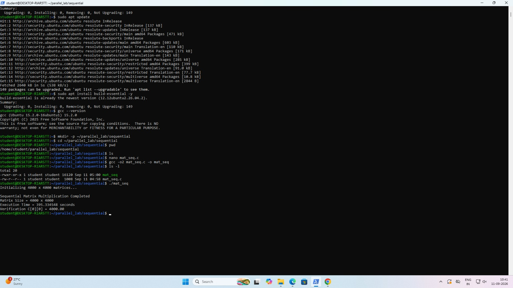

---

# 5. OpenMP Implementation

OpenMP is used to parallelize the matrix multiplication using multiple CPU threads.

The experiment was executed using **8 OpenMP threads**.

### Set Number of Threads

```bash
export OMP_NUM_THREADS=8
```

### Compilation

```bash
gcc -O2 -fopenmp matrix_openmp.c -o matrix_openmp
```

### Execution

```bash
./matrix_openmp
```

### Result

```text
OpenMP Matrix Multiplication Completed

Matrix Size = 4000 x 4000

Number of Threads Used = 8

Execution Time = 92.471771 seconds

Verification C[0][0] = 4000.00
```

### Execution Result

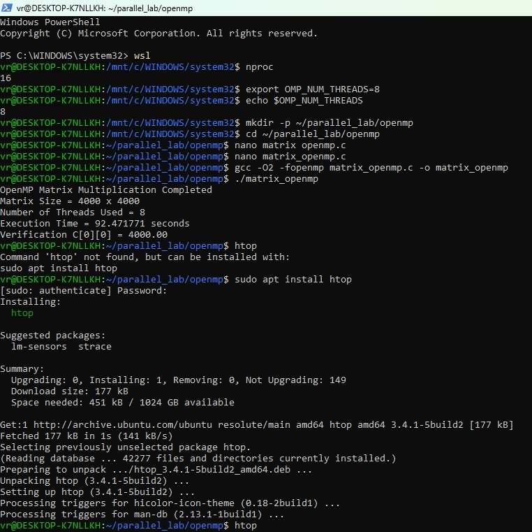

### CPU Resource Monitoring

The `htop` utility was used to observe CPU activity during the OpenMP execution.

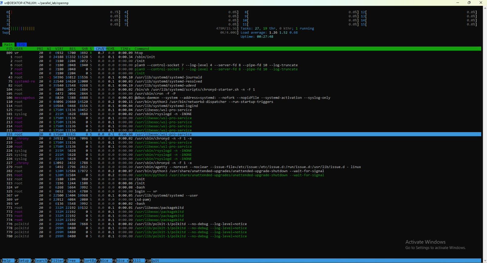

---

# 6. MPI Implementation

MPI is used to distribute the matrix multiplication across four processes running on four Ubuntu virtual machines.

## MPI Nodes

| Node     | IP Address     | Role   |
| -------- | -------------- | ------ |
| Master   | 192.168.20.131 | Rank 0 |
| Worker 1 | 192.168.20.132 | Rank 1 |
| Worker 2 | 192.168.20.133 | Rank 2 |
| Worker 3 | 192.168.20.134 | Rank 3 |

For a 4000 × 4000 matrix and 4 processes, each process handles:

```text
4000 / 4 = 1000 rows
```

## Hostfile

```text
master slots=1

worker1 slots=1

worker2 slots=1

worker3 slots=1
```

## Network and SSH Verification

The master machine successfully communicated with all worker machines.

```text
192.168.20.132 → 0% packet loss

192.168.20.133 → 0% packet loss

192.168.20.134 → 0% packet loss
```

SSH connectivity was also verified for the worker machines.

## Compilation

```bash
mpicc -O2 matrix_mpi.c -o matrix_mpi
```

## Execution

```bash
mpirun -np 4 --hostfile hosts sh -c '$HOME/matrix_mpi'
```

## Result

```text
MPI Matrix Multiplication Completed

Matrix Size = 4000 x 4000

Number of MPI Processes = 4

Execution Time = 92.979510 seconds

Verification C[0][0] = 4000.00
```

## MPI Screenshots

### MPI Setup and Network Verification

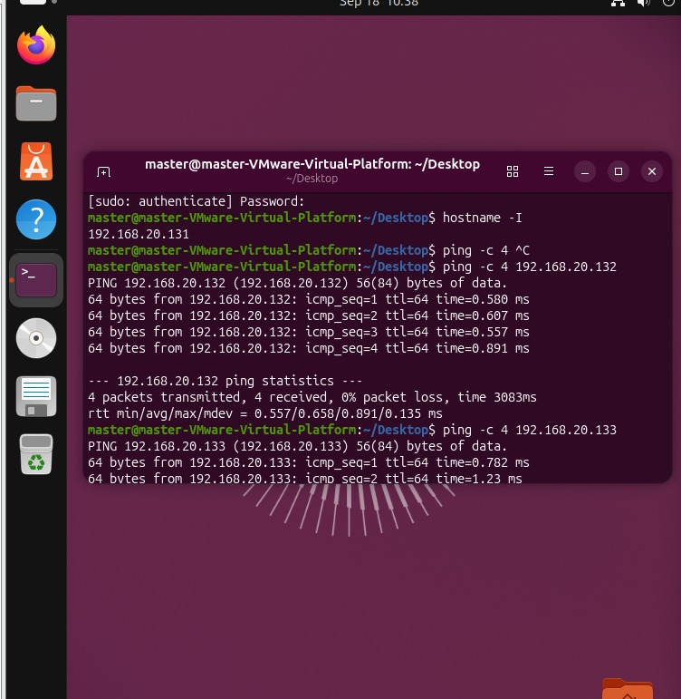

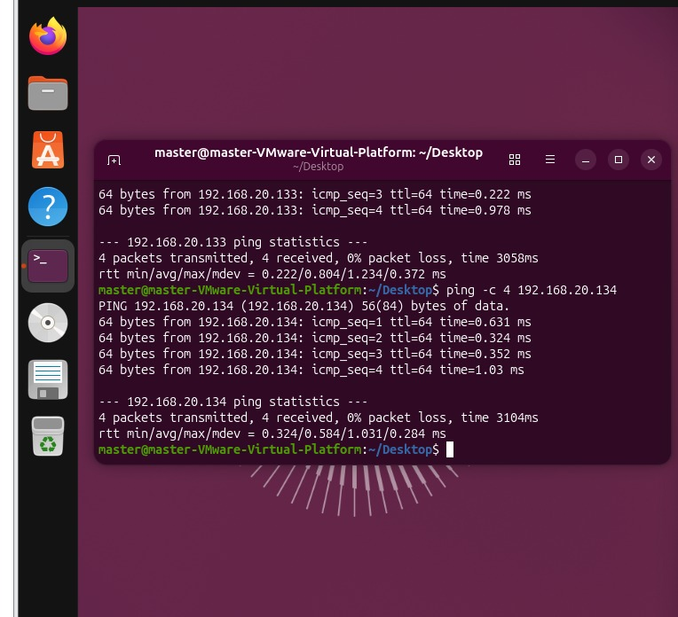

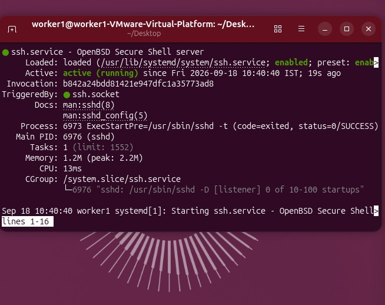

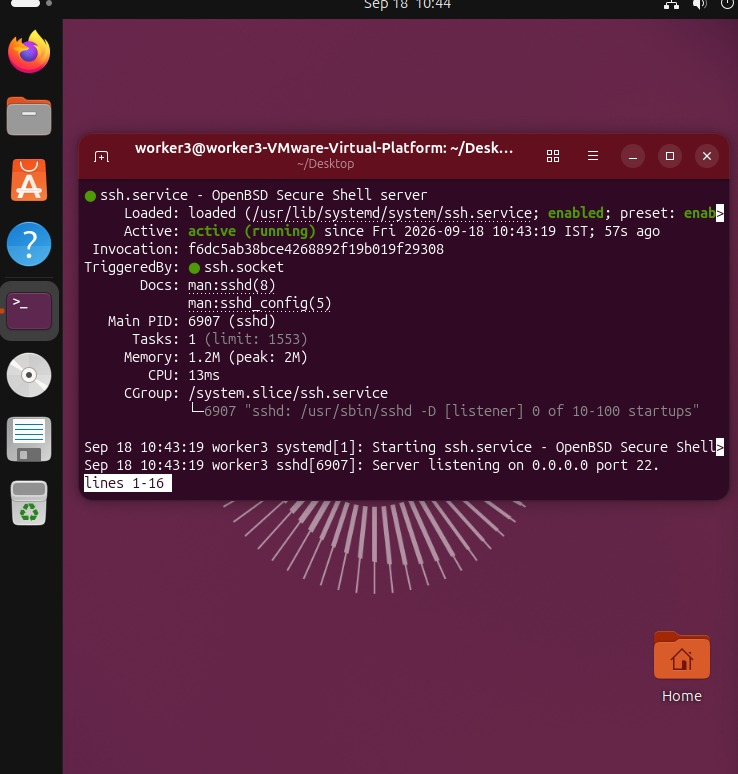

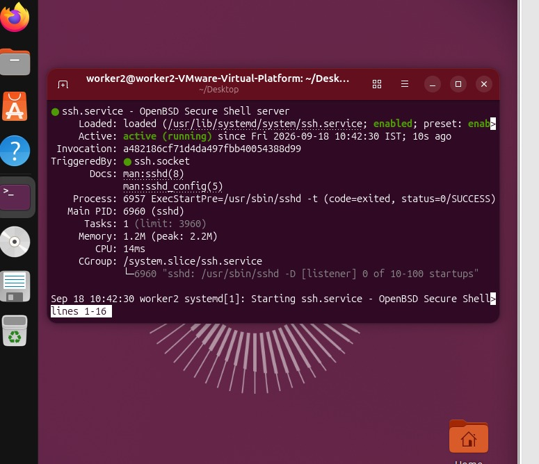

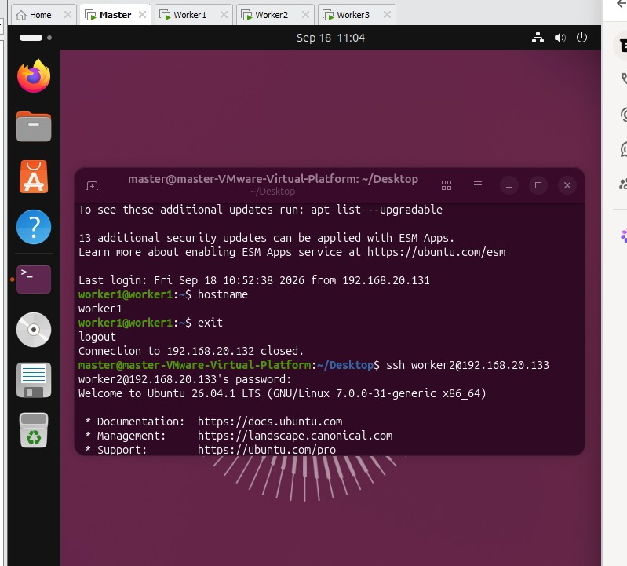

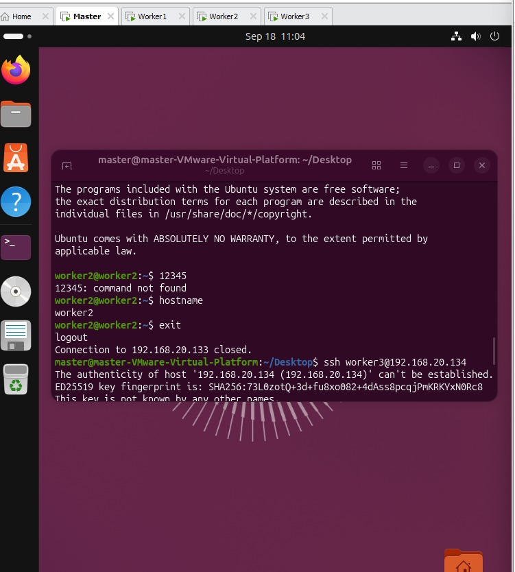

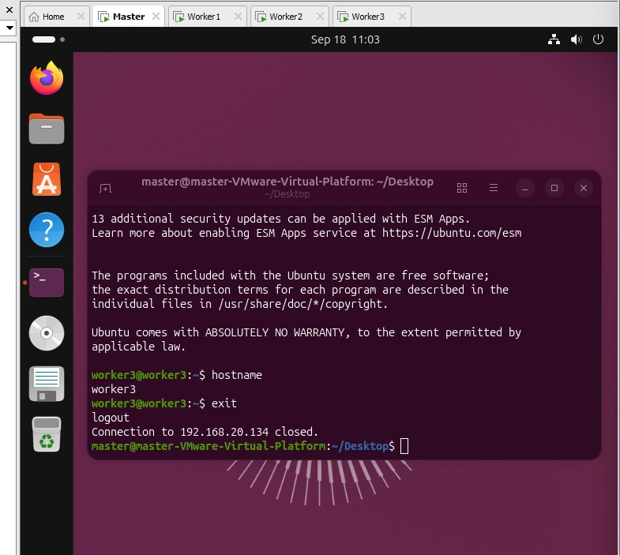

---

# 7. CUDA Implementation

CUDA is used to perform matrix multiplication using GPU parallelism.

Each CUDA thread calculates one output matrix element.

## CUDA Configuration

```text
Matrix Size = 4000 x 4000

Block Size = 16 x 16 threads

Grid Size = 250 x 250 blocks
```

Each block contains:

```text
16 × 16 = 256 threads
```

The grid contains:

```text
250 × 250 = 62,500 blocks
```

## Compilation

```bash
nvcc matrix_cuda.cu -o matrix_cuda
```

## Execution

```bash
./matrix_cuda
```

## Result

```text
CUDA Matrix Multiplication Completed

Matrix Size = 4000 x 4000

Grid Size = 250 x 250 blocks

Block Size = 16 x 16 threads

Kernel Execution Time = 0.280730 seconds

Total CUDA Phase Time = 0.312123 seconds

Verification C[0][0] = 4000.00
```

## GPU Environment

```text
GPU: NVIDIA GeForce RTX 5060 Ti

CUDA Toolkit: 13.3

Ubuntu: 26.04.1 LTS
```

## CUDA Screenshots

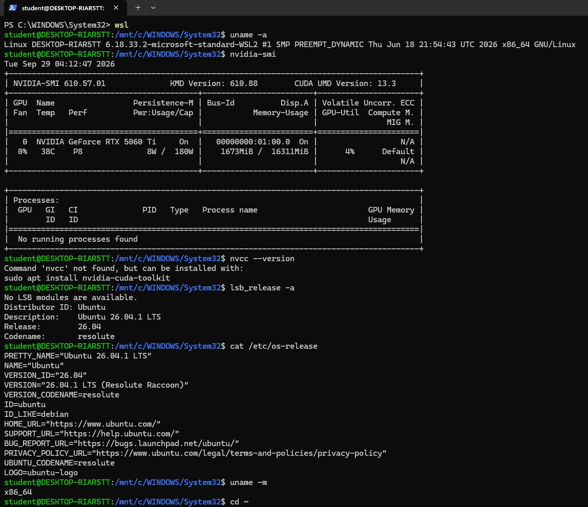

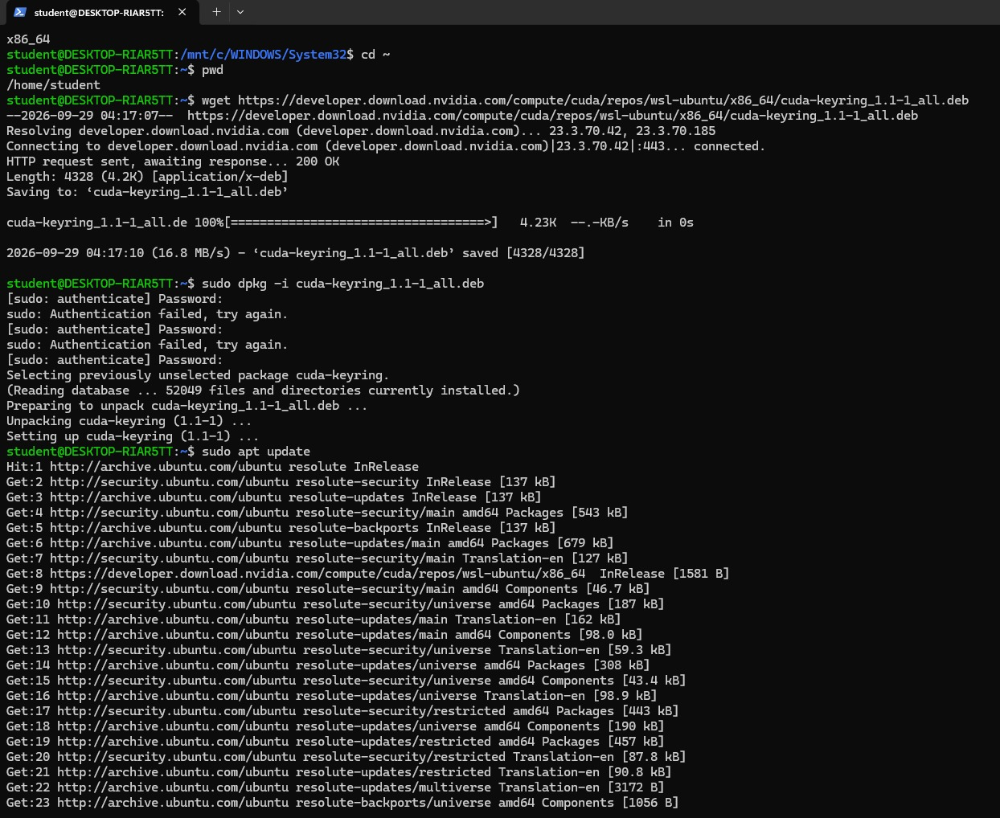

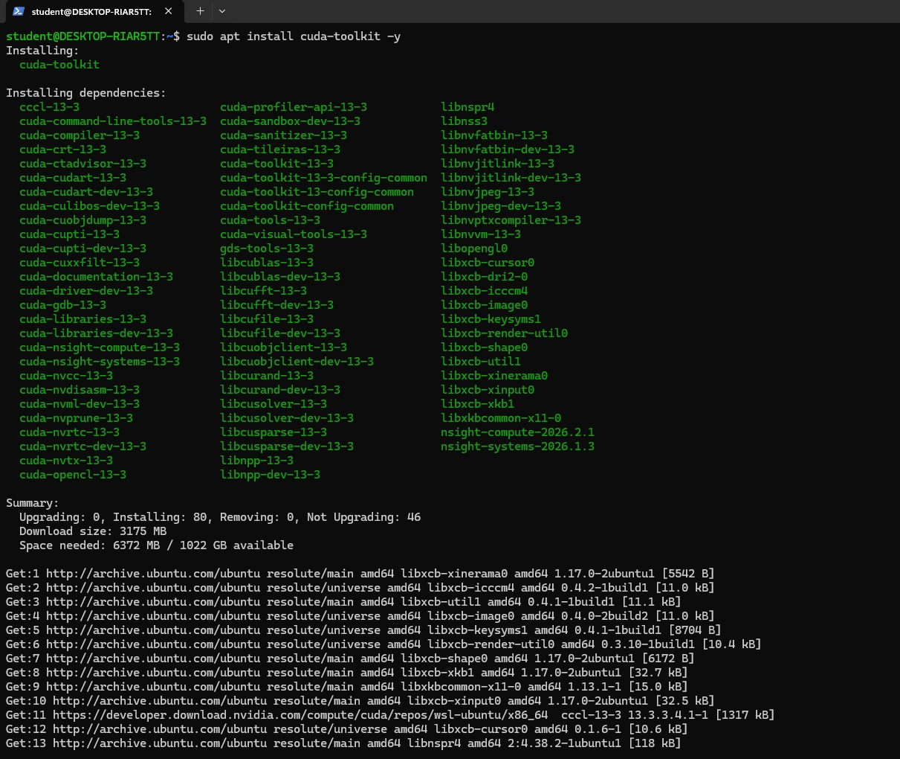

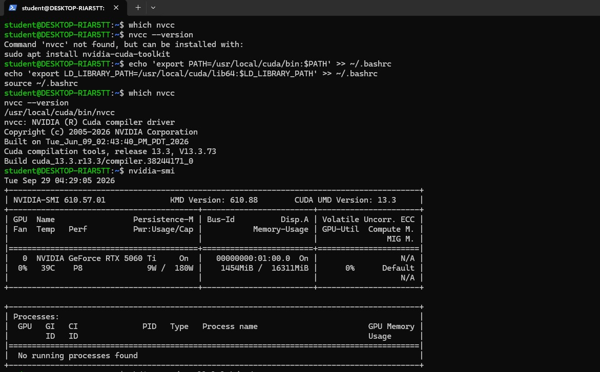

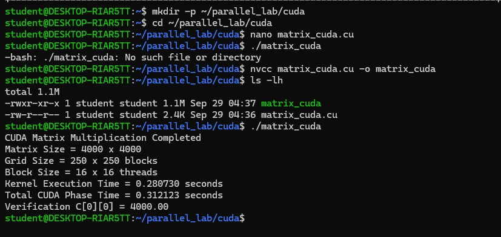

---

# 8. Performance Comparison

| Implementation | Configuration        |   Execution Time |
| -------------- | -------------------- | ---------------: |
| Sequential     | Single CPU execution | **395.334548 s** |
| OpenMP         | 8 CPU threads        |  **92.471771 s** |
| MPI            | 4 processes          |  **92.979510 s** |
| CUDA           | GPU, 16 × 16 blocks  |   **0.312123 s** |

---

# 9. Speedup Comparison

Speedup is calculated using:

```text
Speedup = Sequential Execution Time / Parallel Execution Time
```

### OpenMP

```text
395.334548 / 92.471771 ≈ 4.28×
```

**OpenMP Speedup = 4.28×**

### MPI

```text
395.334548 / 92.979510 ≈ 4.25×
```

**MPI Speedup = 4.25×**

### CUDA

Using the total CUDA phase time:

```text
395.334548 / 0.312123 ≈ 1266.60×
```

**CUDA Speedup = 1266.60×**

---

# 10. Observations

1. Sequential execution provides the baseline performance.

2. OpenMP improves performance by using multiple CPU threads.

3. MPI distributes the computation among multiple processes and virtual machines.

4. CUDA uses GPU parallelism to perform a large number of matrix operations simultaneously.

5. All implementations produce the expected verification result of `4000.00`.

6. CUDA provides the lowest execution time among the implementations.

7. The performance of each approach depends on CPU resources, number of threads or processes, memory access, virtualization overhead, and GPU capabilities.

---

# 11. Conclusion

Matrix multiplication was implemented using Sequential, OpenMP, MPI, and CUDA approaches.

The sequential implementation was used as the baseline. OpenMP provided shared-memory CPU parallelism, while MPI demonstrated distributed-memory parallelism across multiple virtual machines. CUDA used GPU-based parallelism and achieved the lowest execution time in the experiment.

The experiment demonstrates how different parallel computing techniques can improve the performance of computationally intensive operations such as large matrix multiplication.
